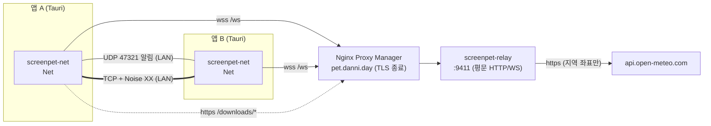
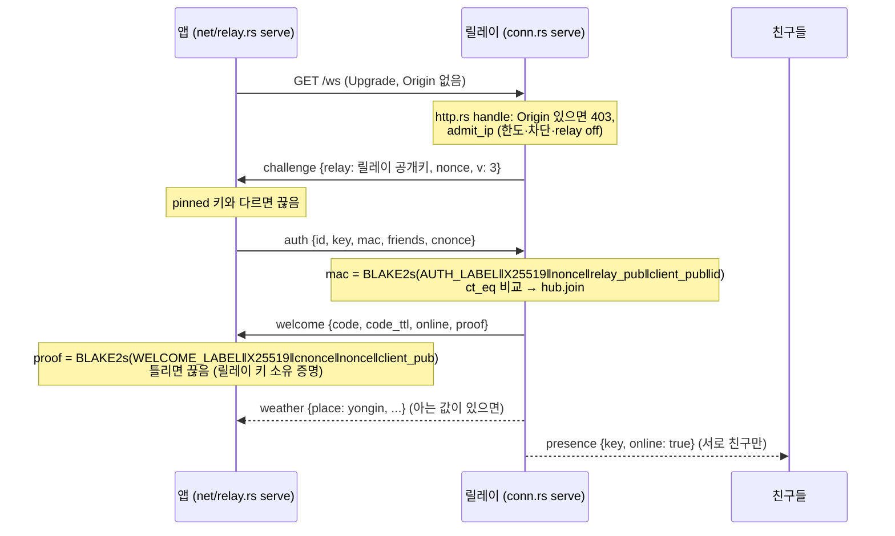
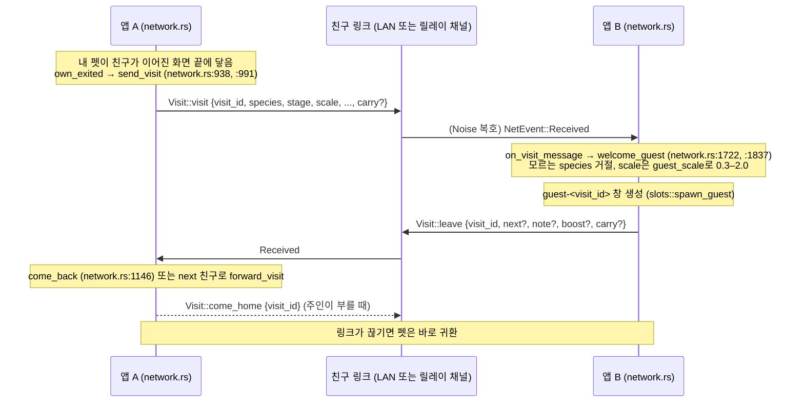
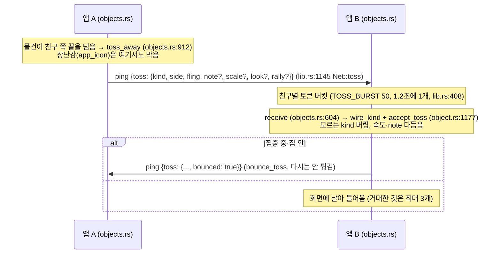
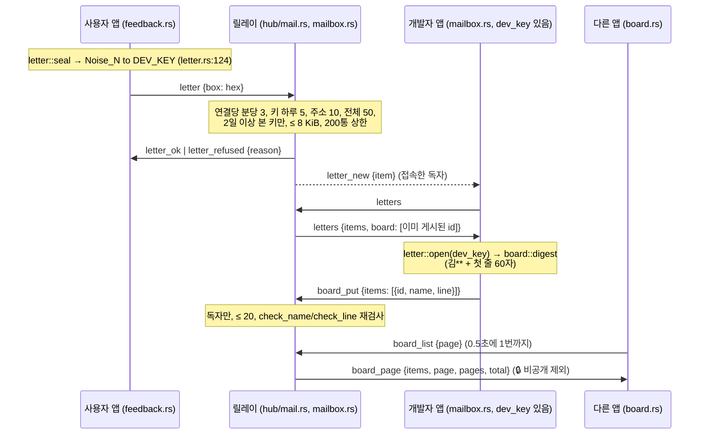
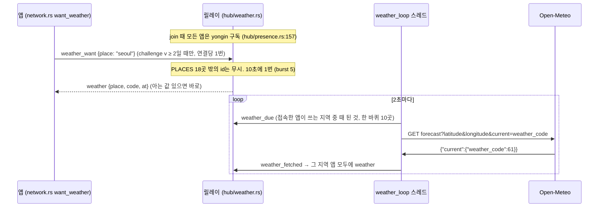
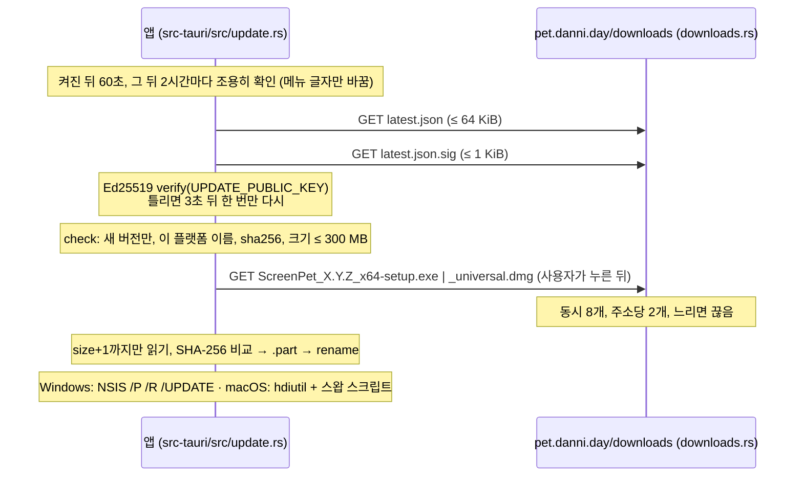

# 서버 ↔ 애플리케이션 통신 구조

> **요약.** 앱끼리는 같은 망이면 UDP 찾기 + TCP로 직접, 아니면 릴레이(`wss://pet.danni.day/ws`)를 거쳐 이어짐.
> 어느 길이든 친구 사이 내용은 끝에서 끝까지 Noise XX로 암호화되고, 릴레이는 4바이트 채널 id가 붙은 암호문만 넘김.
> 릴레이와 앱 사이 제어 메시지는 `t` 꼬리표 JSON(`crates/screenpet-proto`)이고, 친구 사이 메시지는 Noise 안의 `type` 꼬리표 JSON(`crates/screenpet-net/src/protocol.rs`)임.
> 업데이트는 같은 서버의 `https://pet.danni.day/downloads/`에서 서명된 `latest.json`으로 받음.
>
> 기준 커밋: `ba6634b`

---

## 1. 전체 그림



| 길 | 전송 | 무엇이 오감 | 코드 |
|---|---|---|---|
| LAN 찾기 | UDP 브로드캐스트 `255.255.255.255:47321` | `Announce {app, v, id, name, port}` (인증 없는 힌트) | `crates/screenpet-net/src/lib.rs:45` `DEFAULT_DISCOVERY_PORT`, `discovery.rs` `run`, `protocol.rs:523` `Announce` |
| LAN 링크 | TCP (임의 포트), `u16` 빅엔디언 길이 + 프레임 | Noise XX 핸드셰이크 → 암호화된 JSON | `tcp.rs`, `peers.rs` `run_session` |
| 릴레이 제어 | WebSocket 텍스트 프레임 | `ClientMsg` / `ServerMsg` JSON | `crates/screenpet-proto/src/relay.rs` |
| 릴레이 채널 | WebSocket 바이너리 프레임 | `[ch: u32 BE][Noise 프레임 ≤ 65535]` | `crates/screenpet-relay/src/proto.rs:17` `HEADER`, `screenpet-net/src/relay.rs` `new_channel` |
| 업데이트 | HTTPS GET | `latest.json`, `latest.json.sig`, 설치 파일 | `crates/screenpet-core/src/update.rs:9-13`, `src-tauri/src/update.rs` |
| 날씨 | 릴레이 → Open-Meteo HTTPS | 지역 좌표만 (앱 IP는 안 감) | `crates/screenpet-relay/src/weather.rs:61` `open_meteo` |

- TLS는 NPM이 끝냄. 릴레이는 `0.0.0.0:9411` 평문 (`crates/screenpet-relay/src/lib.rs:11`, `deploy/relay/screenpet-relay.service:9`).
- 앱의 wss TLS는 rustls + webpki 루트 (`screenpet-net/src/relay.rs:596` `tls_config`).
- 릴레이 주소·키는 기본값 고정, 바꾸려면 config 폴더의 `relay_url.txt` (1줄 URL 또는 `off`, 2줄 키 hex) (`src-tauri/src/network.rs:465` `relay_settings`).

### 계층 (screenpet-net)

```
 앱 (src-tauri/src/network.rs)   ── Net 메서드 / NetEvent(mpsc) ──
 ┌───────────────────────────────────────────────┐
 │ protocol  : Control / Visit / LadderMsg JSON  │
 │ secure    : SecureLink (큐 → Noise 암호화)     │
 │ peers     : 세션 구동기 (hello, 짝짓기, ping)  │
 │ noise     : XX 핸드셰이크, SAS                 │
 │ transport : FrameLink / FrameReader / dial    │
 ├──────────────────────┬────────────────────────┤
 │ tcp (LAN)            │ relay (WebSocket 채널) │
 └──────────────────────┴────────────────────────┘
```

출처: `crates/screenpet-net/src/lib.rs:1-15` 모듈 설명.

---

## 2. 릴레이 연결 수명

### 2.1 로그인 (challenge → auth → welcome)



| 단계 | 내용 | 코드 |
|---|---|---|
| 업그레이드 | `GET /ws`, `Upgrade: websocket`, 버전 13 아니면 426. `Origin` 머리 있으면 403 | `crates/screenpet-relay/src/http.rs:136-160` |
| 챌린지 | 릴레이 정적 공개키 + 32바이트 nonce + `v` | `crates/screenpet-relay/src/conn.rs:65-70` |
| 키 고정 | 앱은 `DEFAULT_RELAY_KEY`와 비교 | `crates/screenpet-net/src/relay.rs:34`, `:826-830` |
| auth MAC | `screenpet_crypto::auth_mac` | `crates/screenpet-crypto/src/lib.rs:26` |
| 검증 | id 길이 ≤ 128·제어문자 없음, X25519 결과가 0이면 거절, 상수 시간 비교 | `crates/screenpet-relay/src/conn.rs:353` `authenticate`, `proto.rs:20` `dh`, `:30` `ct_eq` |
| 입장 | 차단·등록 한도·이전 연결 `replaced`·설치 저장·코드 발급 | `crates/screenpet-relay/src/hub/presence.rs:93` `join` |
| welcome proof | 앱이 확인. 증명 없는 릴레이는 거절 | `crates/screenpet-crypto/src/lib.rs:31`, `crates/screenpet-net/src/relay.rs:849-856` |
| 인증 마감 | 10초 안에 auth 없으면 `timeout` | `Limits::auth_timeout` (`crates/screenpet-relay/src/lib.rs:147`) |

### 2.2 친구·온라인·채널

- `welcome.online` / `online {keys}`: 나와 **서로** 친구이면서 접속한 키만 (`hub/mod.rs:263` `mutual_online`).
- `presence {key, online}`: 서로 친구에게만 감 (`hub/presence.rs:165-168`, `hub/mod.rs:288` `drop_peer`).
- 친구 목록 바뀌면 앱이 `friends {keys}` 보냄 → 답 `online`. 상한 50키 (`screenpet-proto/src/lib.rs:26`).
- 채널 열기: `open {req, to}` → `opened {req, ch}` + 상대에게 `incoming {ch, from, id}`. 조건 = 서로 친구, 또는 친구 코드 허가(grant) 60초 안 1회 (`hub/routing.rs:12` `open`, `Limits::grant_ttl`).
- 실패 이유: `bad_key`, `self`, `not_friends`, `offline`, `busy` (`hub/routing.rs:18-38`).
- 채널마다 `FrameLink`/`FrameReader` 쌍 → `peers::run_session`으로 LAN TCP와 똑같이 Noise XX를 돌림 (`crates/screenpet-net/src/relay.rs:325` `new_channel`).
- 바이너리 프레임: 길이 `≤ 4` 또는 `> 4 + 65535`면 `bad_frame`으로 끊음 (`conn.rs:305-308`).

### 2.3 친구 코드

- 형식: Crockford base32 8자(40비트) `ABCD-1234`, O→0·I/L→1 정규화 (`crates/screenpet-relay/src/proto.rs:43` `new_code`, `:51` `normalize_code`; 앱도 같은 규칙 `screenpet-net/src/relay.rs:107`).
- 24시간마다 갈림. 연결 스레드가 5초마다 `rotated_code` 확인 후 `code {code, code_ttl}` 보냄 (`conn.rs:325-333`).
- `redeem {code}` → `redeemed {code, key, id}` 또는 `redeem_failed {code, reason}`. 틀린·자기·오프라인 코드는 모두 `unknown` (`hub/presence.rs:215` `redeem`).
- 성공하면 앱이 그 키로 채널을 열고 **SAS 6이모지 짝짓기**를 그대로 돌림 (릴레이는 짝짓기를 확인하지 않음).
- `admin friendcode off` 동안: 코드는 `----`, redeem은 `disabled` (`hub/mod.rs:162` `NO_CODE`).

### 2.4 유지·재연결·깜빡임 유예

| 항목 | 값 | 코드 |
|---|---|---|
| 앱 ping 주기 | 20초 (`ping` → `pong`) | `crates/screenpet-net/src/relay.rs:51` `PING_EVERY` |
| 앱이 죽었다고 보는 때 | 60초 무응답 | `relay.rs:53` `DEAD_AFTER` |
| 릴레이 idle 끊기 | 90초 무수신 → `idle` | `Limits::idle_timeout` |
| 재연결 대기 | 5초부터 실패마다 두 배, 최대 60초. welcome까지 갔으면 다시 5초 | `relay.rs:762` `run`, `:43` `MAX_RETRY`, `lib.rs:118` `relay_retry` |
| 친구 릴레이 다이얼 재시도 | 같은 지수 대기 (친구별) | `relay.rs:490` `dial_done` |
| 다이얼 순서 | id가 작은 쪽 먼저, 큰 쪽은 `announce_interval × 3` 유예. LAN에도 보이면 `× 4` 더 | `relay.rs:502` `auto_dial` |
| 깜빡임 유예 | 끊겨도 30초 동안 메뉴에 온라인으로 보임 (친구, 릴레이 `#relay`) | `crates/screenpet-core/src/flicker.rs:8` `OFFLINE_GRACE_SECS`, `src-tauri/src/network.rs:514` |
| 끊길 때 | 대기 중 편지·건의함 요청은 `offline`으로 실패 처리, 채널 닫힘 | `relay.rs:792` `disconnected` |

- 릴레이 링크로 붙은 친구는 나중에 LAN에서 보이면 작은 id 쪽이 LAN으로 올림 (`relay.rs` 모듈 설명 9-11줄, `discovery.rs`).
- 같은 키로 다시 로그인하면 옛 연결은 `replaced`로 끊김 (`hub/presence.rs:132-141`).

---

## 3. 릴레이 메시지 카탈로그 (`crates/screenpet-proto/src/relay.rs`)

텍스트 프레임은 `{"t": "<snake_case>", ...}`. 최소 버전 = 앱이 보내기 전에 확인하는 challenge `v`.

### 3.1 앱 → 릴레이 (`ClientMsg`, `relay.rs:53`)

| `t` | 필드 | 용도 | 최소 v | 누가 |
|---|---|---|---|---|
| `auth` | `id, key, mac, friends[], cnonce?` | 로그인 | 0 | 모두 |
| `friends` | `keys[]` | 친구 키 목록 갱신 → `online` | 0 | 모두 |
| `redeem` | `code` | 친구 코드 쓰기 | 0 | 모두 |
| `new_code` | – | 코드 새로 받기 (연결당 5번) | 0 | 모두 |
| `open` | `req, to` | 채널 열기 | 0 | 모두 |
| `close` | `ch` | 채널 닫기 | 0 | 모두 |
| `ping` | – | 유지 → `pong` | 0 | 모두 |
| `letter` | `box` (hex) | 봉인된 건의 편지 → `letter_ok`/`letter_refused` | 0 (v0.6.0 릴레이) | 모두 |
| `letters` | – | 편지 목록 → `letters` | 0 | 편지함 독자 |
| `letter_read` | `id` | 읽음 | 0 | 독자 |
| `letter_delete` | `id` | 지우기 (요약도) | 0 | 독자 |
| `letter_done` | `id, done` | ✅ 반영 (false면 반려도 지움) | 0 | 독자 |
| `letter_block` | `from` | 보낸이 차단 + 그 편지 삭제 | 0 | 독자 |
| `weather_want` | `place` | ☀️ 기본 지역 id 고르기 | **2** | 모두 |
| `letter_reject` | `id, rejected` | 🙅 반려 | **3** | 독자 |
| `letter_private` | `id, private` | 🔒 공개 건의함에서 숨김 | **3** | 독자 |
| `board_put` | `items[{id, name, line}]` (≤ 20) | 📮 공개 요약 올리기 | **3** | 독자 |
| `board_list` | `page` | 📮 공개 건의함 한 쪽 → `board_page` | **3** | 모두 |

### 3.2 릴레이 → 앱 (`ServerMsg`, `relay.rs:135`)

| `t` | 필드 | 용도 | 비고 |
|---|---|---|---|
| `challenge` | `relay, nonce, v` | 로그인 시작 | `v` 없으면 0 |
| `welcome` | `code, code_ttl, online[], proof?` | 로그인 성공 | proof는 `cnonce` 있을 때 |
| `online` | `keys[]` | `friends` 답 | |
| `presence` | `key, online` | 친구 접속·끊김 | 서로 친구만 |
| `code` | `code, code_ttl` | 코드 갈림·새 코드 | |
| `redeemed` / `redeem_failed` | `code, key, id` / `code, reason` | 코드 쓰기 결과 | reason: `unknown`·`rate`·`disabled` |
| `opened` / `open_failed` | `req, ch` / `req, reason` | 채널 열기 결과 | |
| `incoming` | `ch, from, id` | 상대가 채널을 엶 | |
| `close` | `ch` | 채널 닫힘 | |
| `pong` | – | ping 답 | |
| `error` | `reason` | 그 뒤 연결 닫힘 | 아래 표 |
| `letter_ok` / `letter_refused` | – / `reason` | 편지 결과 | reason: `daily`·`ip`·`new`·`global`·`full`·`size`·`blocked` |
| `letters` | `items[Letter], board[]` | 편지 목록 + 이미 게시된 id | `board`는 v3 |
| `letter_new` | `item` | 새 편지 (접속한 독자에게) | |
| `letters_changed` | – | 편지함 바뀜 (독자 모두) | |
| `weather` | `place, code (WMO 0–99), at` | ☀️ 지역 날씨 | v2 |
| `board_page` | `items[{id,name,line,at,status}], page, pages, total` | 📮 한 쪽 (5개, 최신 먼저) | v3, `status`: `none`·`done`·`rejected` |

`error.reason` 값 (`conn.rs`, `hub/presence.rs` `join`, `hub/mod.rs`): `auth`, `timeout`, `idle`, `rate`, `too_large`, `bad_message`, `bad_frame`, `unexpected`, `slow`, `busy`, `banned`, `registration_closed`, `full`, `replaced`, `relay_off`, `shutdown`.

---

## 4. 친구 사이 메시지 (Noise 채널 안, `crates/screenpet-net/src/protocol.rs`)

`{"type": "<snake_case>", ...}`. 최상위 `Message`는 꼬리표 없는 `Control | Visit | LadderMsg` (`protocol.rs:498`). 최대 JSON = `65535 − 16` (`protocol.rs:27` `MAX_MESSAGE`).

### 4.1 Control (`protocol.rs:328`)

| `type` | 필드 | 용도 | 최소 상대 v |
|---|---|---|---|
| `hello` | `id, name, v, friend` | 핸드셰이크 뒤 첫 메시지 (양방향) | 1 |
| `invite` | `pet, commit` | 짝짓기 요청 (`commit = BLAKE2s(nonce_i)`) | 1 |
| `pair_random` | `random` | 초대받은 쪽 난수 r_r | 1 |
| `pair_reveal` | `nonce` | 초대자가 nonce_i 공개 | 1 |
| `invite_reply` | `accepted` | SAS 확인/거절 | 1 |
| `unfriend` | – | 친구 끊기 | 1 |
| `ping` | `ask?, steer?, toss?` | 유지 + 요청·조종·던진 물건 | 1 (필드는 옛 버전이 무시) |
| `device_friends` | `friends[], want` | 📱 내 컴퓨터끼리 친구 목록 | 3 |
| `my_devices` | `devices[]` | 📱 내 다른 컴퓨터 소개 | 3 |
| `device_code` / `device_code_nonce` / `device_code_proof` / `device_code_ok` / `device_no` | nonce·proof·reason | 📱 코드로 연결 | 3 |
| `device_nonce` / `device_proof` / `device_unlink` / `device_confirm` | | 📱 비밀 S 증명·해제·확인 | 3 |
| `device_active` / `device_state` | term·you·idle·meet / pet·care·handover | 📱 누가 노는지, 펫·돌봄 넘기기 | 3 |

### 4.2 Visit (`protocol.rs:229`)

| `type` | 주요 필드 | 용도 |
|---|---|---|
| `visit` | `visit_id, species, stage, scale, personality, owner, enter_side`, 선택: `vside, via, homesick_in, fling, note, gift, style, tint, boost, no_grow, of, carry` | 펫이 놀러 감 |
| `leave` | `visit_id`, 선택: `next, side, vside, homesick_in, fling, note(답장), boost, carry` | 손님이 떠남 (집 또는 다음 친구) |
| `come_home` | `visit_id` | 주인이 부름 |

### 4.3 Ping에 실리는 것

| 구조 | 필드 | 받는 쪽 검사 |
|---|---|---|
| `Toss` (`protocol.rs:101`) | `kind, side, vside?, fling?, note?, bounced, scale?, look?, rally?` | `kind`는 허용 목록, `rally`는 `MAX_RALLY`(20)로 자름 (`protocol.rs:136`) |
| `Steer` (`protocol.rs:85`) | `visit_id, on, keys` 비트 | 그 친구의 그 손님에게만 |
| `ask` | `"invite"`, `"busy"` 등 문자열 | 앱이 해석 |

### 4.4 LadderMsg (`protocol.rs:463`, 최소 상대 v 2)

`ladder_invite`, `ladder_join`, `ladder_decline`, `ladder_lock`, `ladder_reveal`, `ladder_reveals`, `ladder_start`, `ladder_cancel`. commit–reveal 시드 (`crates/screenpet-net/src/ladder.rs`).

### 4.5 Noise 암호 계층

| 항목 | 값 | 코드 |
|---|---|---|
| 패턴 | `Noise_XX_25519_ChaChaPoly_BLAKE2s`, 다이얼한 쪽 = initiator | `crates/screenpet-net/src/noise.rs:27` |
| 프롤로그 | `screenpet-net/1` | `noise.rs:29` |
| 전송 | ChaCha20-Poly1305, 암묵 nonce → 재전송·순서 바꿈·끼워 넣기 불가 | `noise.rs:8`, 복호 실패 시 링크 끊음 `peers.rs:149` |
| 친구 판정 | hello의 id가 고정된 키와 같고 상대도 우리를 고정(`friend: true`) | `peers.rs` 모듈 설명 |
| SAS | `BLAKE2s(handshake_hash‖nonce_i‖r_r)` 앞 36비트 → 이모지 6개 (64종) | `noise.rs:32` `SAS_EMOJI`, `:48` `sas` |
| 큐 | 호출자는 큐에 넣기만, writer 스레드가 암호화 | `crates/screenpet-net/src/secure.rs` |

---

## 5. 버전·호환 규칙

| 상수 | 값 | 의미 | 위치 |
|---|---|---|---|
| `RELAY_PROTOCOL_VERSION` | 3 | challenge `v` | `crates/screenpet-proto/src/lib.rs:15` |
| `WEATHER_MIN_VERSION` | 2 | `weather_want` 보내도 되는 릴레이 | `lib.rs:17` |
| `BOARD_MIN_VERSION` | 3 | `board_*`, `letter_reject`, `letter_private` | `lib.rs:19` |
| P2P `PROTOCOL_VERSION` | 4 | `hello.v`, `Announce.v` | `crates/screenpet-net/src/protocol.rs:11` |
| `LADDER_MIN_VERSION` | 2 | 사다리 메시지 | `protocol.rs:13` |
| `DEVICES_MIN_VERSION` | 3 | `device_*` | `protocol.rs:15` |
| `CARRY_MIN_VERSION` | 4 | `Visit.carry` (옛 버전은 필드를 무시해 물건이 사라지므로 안 보냄) | `protocol.rs:18` |

규칙:

- **모르는 `t`**: 릴레이는 파싱 실패 → `bad_message`로 끊음 (`conn.rs:161-164`). 그래서 앱이 `v`를 보고 보냄 (`screenpet-net/src/relay.rs:92` `WEATHER_RELAY_VERSION`, `:95` `BOARD_RELAY_VERSION`, `:971`).
- **앱이 받는 모르는 `t`**: 그냥 무시 (`screenpet-net/src/relay.rs:918` "newer relay message: ignore").
- **모르는·빠진 필드**: 양쪽 `#[serde(default)]`로 너그럽게. `BoardStatus`의 모르는 값은 `none` (`relay.rs:263` `#[serde(other)]`).
- **친구 링크의 모르는 `type`**: `Message::parse` 실패 → 링크 끊음 (`peers.rs:150`). 그래서 새 메시지 종류는 상대 `v` 확인 뒤에만 (`Net::peer_version`).
- **새 기능은 필드로**: `Ping`·`Visit`에 선택 필드를 붙여 옛 버전은 무시하게 함. 깨진 값은 그 필드만 버리는 `lenient` 역직렬화 (`protocol.rs:55-62`, `:160-176`).
- 와이어 글자는 `crates/screenpet-proto/tests/golden.rs`가 고정함. 라벨(`screenpet-relay/1 auth` 등)을 바꾸면 옛 앱이 못 붙음 (`crates/screenpet-crypto/src/lib.rs:6-8`).
- 배포 순서: 릴레이 먼저, 앱 나중 (`deploy/relay/README.md` "Deploy the relay before an app that sends letters").

---

## 6. 시퀀스

### 6.1 펫이 친구에게 놀러 감



### 6.2 물건 던지기



### 6.3 건의 편지 (봉인) + 공개 건의함



### 6.4 날씨 구독



### 6.5 업데이트 확인·받기



- 리다이렉트는 같은 호스트 https만 직접 따라감 (`crates/screenpet-core/src/update.rs:247` `redirect_target`, `src-tauri/src/update.rs:143` `get`).
- 자세한 무결성 규칙은 [security.md](security.md) §4.
