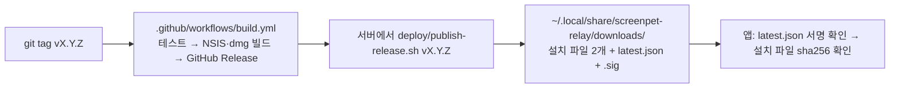

# 릴레이 서버 구조 (`crates/screenpet-relay`)

> **요약.** 릴레이는 std 스레드 + 동기 `tungstenite`로 도는 단일 프로세스임. 연결 하나 = 스레드 하나이고, 모든 공유 상태는 `Hub` 안 `state` 잠금 하나(+ 편지함 잎 잠금)에 있음.
> 디스크에는 설치 목록(`relay.json`), 릴레이 키, 운영 스위치, 봉인된 건의 편지만 둠 (메시지 내용 없음). 쓰기는 모두 임시 파일 → fsync → `.bak` → rename.
> 같은 포트에서 `/healthz`, `/ws`, `/downloads/*`를 답하고, 날씨는 별도 스레드가 Open-Meteo에서 받아 옴. systemd 사용자 유닛 + NPM(TLS) 뒤에서 돎.
>
> 기준 커밋: `ba6634b`

---

## 1. 프로세스 모델

```
main.rs ─ SIGTERM/SIGINT 막고 sigwait ─┐
                                       ▼
Relay::start (lib.rs:224)
 ├─ relay-accept   accept_loop    : 20 ms 논블로킹 accept → 연결마다 relay-conn 스레드
 ├─ relay-upkeep   upkeep_loop    : 60 s maintain, 10 min prune_store, 30 s save
 ├─ relay-weather  weather_loop   : 2 s마다 때 된 지역을 Open-Meteo에서 (잠금 밖)
 ├─ relay-admin    admin::serve   : admin.sock 하나씩 처리 (unix만)
 └─ relay-conn × N http::handle   : /healthz | /ws → conn::serve | /downloads → Downloads::serve
```

| 항목 | 내용 | 코드 |
|---|---|---|
| 진입 | 인자·환경 변수 읽고 `Relay::start`, 시그널 오면 `drop(relay)` → 알림·스레드 종료·저장 | `crates/screenpet-relay/src/main.rs:83` `main` |
| 시그널 | 스레드 띄우기 전 SIGTERM·SIGINT를 막고 `sigwait`로 받음 (핸들러 없음) | `main.rs:32` `mod signals` |
| 연결 스레드 수 | `max_conns + 16` 넘으면 안 띄움 (`threads_refused` 카운터) | `hub/mod.rs:453` `Hub::spawn` |
| fd 한도 | soft `RLIMIT_NOFILE`을 `max_conns + 64`까지 올리고, 모자라면 `max_conns`를 줄임 | `lib.rs:309` `conns_within_fd_limit` |
| 연결 루프 | 큐 → 소켓 쓰기, 소켓 → 허브 읽기, 타이머 확인. 읽기 대기 15 ms (프레임 흐를 때) / 100 ms (쉴 때) | `conn.rs:60` `serve`, `:18-22` `POLL`·`POLL_IDLE` |
| 스레드 간 통신 | 다른 연결로는 `Out` 큐(`sync_channel(512)`)로만 보냄. 큐가 차면 `slow`로 끊음 | `hub/mod.rs:52` `Out`, `:116` `Peer::send`, `conn.rs:15` `OUTBOX` |
| 종료 | `Drop for Relay`: stop → join → `join_all` → `save` → `admin.sock` 삭제 | `lib.rs:282` |

### 1.1 잠금과 순서 (`hub/mod.rs:13-22`)

| 잠금 | 지키는 것 | 규칙 |
|---|---|---|
| `state: Mutex<State>` | 접속(`peers`), 채널, grant, 주소별 한도 표, `Control`, 날씨, 설치 `Store` | 거의 모든 일이 이 하나. 접속·채널이 얽혀 나누지 않음 |
| `mail: Mutex<Mailbox>` | 편지함 | **잎 잠금**: `state` → `mail`은 됨, `mail`을 쥔 채 다른 잠금 금지 |
| `mailbox_save: Mutex<()>` | `letters.json` 쓰기 순서 | `state`를 놓은 뒤에만, 안에서 `mail`만 잠깐 |
| `threads: Mutex<Vec<JoinHandle>>` | 스레드 목록 | 다른 잠금과 안 섞임 |
| 원자값 | 카운터, 큐 바이트, `relay_off`, `stop` | 잠금 없음 |

순서: `mailbox_save → mail`, `state → mail`. 거꾸로 없음. 독이 든 잠금도 `into_inner()`로 계속 씀 (`hub/mod.rs:423`).
`relay.json` 쓰기는 `state` 안에서 `Snapshot`만 뜨고 실제 쓰기는 잠금 밖 (`store.rs` 모듈 설명, `:413` `write_snapshot`).

### 1.2 모듈 지도

| 파일 | 역할 |
|---|---|
| `main.rs` | 실행 파일. `--bind/--data/--trusted-proxy`, `admin` 하위 명령 |
| `lib.rs` | `Limits`(모든 기본 한도), `RelayConfig`, `Relay::start`, accept/upkeep/weather 루프 |
| `http.rs` | 최소 HTTP 앞단: 머리 8 KiB·5 s, 경로 분기, 프록시 뒤 클라이언트 주소, WS 업그레이드 |
| `conn.rs` | WS 연결 하나: challenge → auth → 메시지 루프, 연결별 버킷 |
| `proto.rs` | `screenpet_proto` 재수출 + `dh`, `ct_eq`, 친구 코드 생성·정규화 |
| `hub/mod.rs` | `Hub`, `State`, `Peer`, `Channel`, `Grant`, 잠금 규칙 |
| `hub/presence.rs` | `admit_ip`, `join`, `leave`, `set_friends`, `redeem`, 코드, `prune_store`, `save` |
| `hub/routing.rs` | `open`/`close`/`forward`, 대역폭·큐 한도 |
| `hub/mail.rs` | 편지 받기, 독자 편집, `board_put`/`board_list`, `mailbox-reader` 관리 |
| `hub/weather.rs` | 앱별 지역 기억, `weather_due`/`weather_fetched` |
| `hub/admin.rs` | `admin_*` 명령 처리 (kick, ban, purge …) |
| `hub/stats.rs` | `Counters`, `admin status` 글 |
| `hub/limits.rs` | `Bucket`(토큰 버킷), 미닫이 창 표, 주소→네트워크 묶기 |
| `store.rs` | `relay.json` 설치 저장소, `relay.key`, `write_private` |
| `mailbox.rs` | `letters.json`: 봉인 편지 + 공개 요약, 보내기 한도 |
| `board.rs` | 📮 공개 요약 재검사(`check_name`, `check_line`), 쪽 계산 |
| `weather.rs` | Open-Meteo 받기(`open_meteo`), `Weathers` 표 |
| `downloads.rs` | `/downloads/` 정적 파일, 이름 허용 목록, 자리·속도 한도 |
| `control.rs` | `control.json`: 스위치·차단·편지함 독자 |
| `admin.rs` | `admin.sock` 서버·클라이언트, `USAGE` |

---

## 2. 디스크 데이터

기본 폴더 `~/.local/share/screenpet-relay` (`$XDG_DATA_HOME` 우선, `SCREENPET_RELAY_DATA`/`--data`로 바꿈) (`main.rs:15` `default_data_dir`).
폴더 0700, 파일 0600 (`store.rs:108` `private_dir`, `:453` `write_private`).

| 파일 | 내용 | 형식 | 깨졌을 때 | 코드 |
|---|---|---|---|---|
| `relay.key` | 릴레이 X25519 정적 개인키 | hex | 없으면 새로 만듦 (임시 → rename) | `store.rs:429` `load_or_create_key` |
| `relay.json` (+`.bak`, `.tmp`) | 설치 키 → `{id, friends[], code, code_at, last_seen, active, seen_days}` | JSON | `.bak`, 그래도 안 되면 빈 저장소로 시작 | `store.rs:44` `Install`, `:125` `Store::open` |
| `control.json` | `registration`, `friendcode`, `relay`, `banned_keys`, `banned_ips`, `mailbox_readers` | JSON | **시작 거부** (차단이 조용히 풀리면 안 됨) | `control.rs:18`, `:47` `load` |
| `letters.json` (+`.bak`) | 봉인 편지(hex), 상태, 보낸 기록(`sent`), 차단 키, 공개 요약(`board`) | JSON | `.bak`, 그래도 안 되면 빈 편지함 | `mailbox.rs:342` `load`, `:357` `save` |
| `admin.sock` | 관리 소켓 (0600) | Unix socket | 시작 때 남은 것 지움 | `admin.rs:45` `bind` |
| `downloads/` | `latest.json`, `latest.json.sig`, 설치 파일 2개 | 정적 | – | `downloads.rs` |

저장 방식 (`store.rs:413` `write_snapshot`): 0600 임시 파일 쓰기 → fsync → 옛 파일을 `.bak`으로 rename → 임시 파일을 본 이름으로 rename → 폴더 fsync. `letters.json`도 같은 방식 (`mailbox.rs:357`), `control.json`은 `.bak` 없이 임시 → rename → 폴더 fsync (`control.rs:70` `save`).

- 저장 주기: 바뀐 게 있으면 30초마다, 종료 때 (`Limits::save_every`).
- `last_seen`만 바뀐 것은 설치당 10분에 한 번만 더럽힘 (`store.rs:28` `TOUCH_EVERY_SECS`).
- 설치 보존 (`store.rs:361` `keep_for`, `:373` `prune_with`):

| 설치 | 안 보이면 잊는 시간 |
|---|---|
| 친구 없고 코드 사용에도 안 낀 설치 | 24시간 (`IDLE_FORGET_SECS`) |
| 친구 있지만 서로 다른 날 7일 미만 | 14일 (`NEW_FRIEND_FORGET_SECS`) |
| 자리 잡은 설치 (7일+) | 180일 (`FORGET_AFTER_SECS`) |
| 접속 중 | 절대 안 잊음 |

- 저장 설치 상한 20 000. 차면 오래된 친구 없는 오프라인 설치부터 내보냄, 없으면 `full` (`store.rs:30`, `:247` `register_with`).

---

## 3. 한도와 속도 제한

### 3.1 `Limits::default()` (`crates/screenpet-relay/src/lib.rs:132-183`)

| 분류 | 필드 | 값 |
|---|---|---|
| 메시지 크기 | `max_text` | 16 KiB |
| 연결 버킷 | `conn_msgs_per_sec` / `burst` | 200/s, 400 |
| | `conn_bytes_per_sec` / `burst` | 512 KiB/s, 1 MiB |
| 채널 버킷 (방향당) | `chan_msgs_per_sec` / `burst` | 20/s, 40 |
| 친구·채널 | `max_friends` / `max_channels` / `max_channels_per_pair` | 50 / 64 / 2 |
| 시간 | `idle_timeout` / `auth_timeout` | 90 s / 10 s |
| 코드 | `code_ttl` / `grant_ttl` | 24 h / 60 s |
| 코드 사용 | `redeems_per_ip_per_min` / `redeems_per_min` / `redeems_per_target_per_hour` | 30 / 600 / 10 |
| 새 설치 | `registrations_per_hour` (전체) / `_per_ip_per_hour` (/24·/64) / `_per_network_per_day` (/24·/48) | 2000 / 30 / 100 |
| | `new_codes_per_network_per_hour` | 64 |
| 저장소 | `max_installs` | 20 000 |
| 연결 수 | `max_conns` / `_per_ip` / `_per_network` | 2048 / 16 / 128 |
| 인증 전 연결 | `max_unauthed` / `_per_ip` / `_per_network` | 512 / 8 / 32 (차면 가장 오래된 것을 `busy`로 내보냄) |
| 대역폭 (친구 프레임) | `ip_bytes_per_sec` / `burst` | 2 MiB/s, 4 MiB |
| | `global_bytes_per_sec` / `burst` | 16 MiB/s, 32 MiB (천장은 두 배, `hub/mod.rs:394`) |
| 큐 | `max_outbox_bytes` / `max_total_outbox_bytes` / `slow_after` | 2 MiB / 256 MiB / 5 s |
| 저장 | `save_every` / `prune_every` | 30 s / 600 s |
| 📮 | `board_gap` | 500 ms (더 빠른 `board_list`는 답 없음) |
| 🔄 다운로드 | `max_downloads` / `_per_ip` | 8 / 2 |
| | `download_deadline` / `min_rate` / `grace` / `stall` | 30 min / 64 KiB/s / 20 s / 10 s |

### 3.2 연결별 상수 (`crates/screenpet-relay/src/conn.rs`)

| 상수 | 값 | 넘으면 |
|---|---|---|
| `REDEEMS_PER_CONN_PER_MIN` (`:24`) | 10 | `redeem_failed {reason: rate}` |
| `LETTERS_PER_CONN_PER_MIN` (`:26`) | 3 | `letter_refused {reason: daily}` |
| `NEW_CODES_PER_CONN` (`:28`) | 5 | 무시 |
| `FRIENDS_PER_SEC` / `FRIENDS_BURST` (`:31`, `:33`) | 0.5/s, 30 | `rate`로 끊음 |
| `WEATHER_WANTS_PER_SEC` / `BURST` (`:35`, `:37`) | 0.1/s, 5 | 무시 |

### 3.3 그 밖

- 채널 프레임: `HEADER(4) + MAX_FRAME(65535)`. WS 설정도 같은 상한 (`http.rs:113` `ws_config`).
- 주소 키: IPv4 그대로, IPv6 /64 (`http.rs:81` `bucket`). 네트워크: IPv4 /24, IPv6 /48 (`hub/limits.rs:93` `parent_of`). 넓은 묶음: /16, /32 (`:108` `wide_bucket`).
- 속도 표 키 상한 8192, 네트워크당 16 (`hub/limits.rs:69` `MAX_RATE_KEYS`, `:90` `MAX_KEYS_PER_PARENT`).
- 네트워크당 전체 대역폭 몫 1/16 (`hub/routing.rs:6` `NET_BYTES_SHARE`).
- 편지함 한도 (`mailbox.rs:14-28`): 키당 하루 5, 주소당 10, 전체 50, 2일 이상 본 키만, 봉인 ≤ 8 KiB, 200통에서 새 편지 거절.
- 공개 요약: `board_put` 하나에 ≤ 20, 이름 ≤ 16자, 줄 ≤ 80자, 5개/쪽 (`crates/screenpet-proto/src/board.rs`).

---

## 4. 외부 호출: Open-Meteo (`crates/screenpet-relay/src/weather.rs`)

| 항목 | 값 | 위치 |
|---|---|---|
| URL | `https://api.open-meteo.com/v1/forecast?latitude=..&longitude=..&current=weather_code&timezone=GMT` | `:40` `url` |
| 클라이언트 | `ureq`, `https_only`, 리다이렉트 0, UA `screenpet-relay/<ver>` | `:61` `open_meteo` |
| 시간 제한 | 연결 5 s, 전체 10 s | `:25`, `:27` |
| 답 크기 | 16 KiB | `:23` `BODY_LIMIT` |
| 주기 | 성공 뒤 30 min, 실패 뒤 5 min (마지막 좋은 값 유지) | `:15` `POLL_EVERY`, `:17` `RETRY_AFTER` |
| 바퀴 | 2 s마다, 한 바퀴 최대 10곳, 하나씩 순서대로 | `lib.rs:385` `WEATHER_ROUND`, `weather.rs:21` |
| 잊기 | 2 h 아무도 안 원한 지역 | `:19` `FORGET_AFTER` |
| 지역 | 고정 18곳 (`screenpet_proto::weather::PLACES`), 표 밖 id 무시 | `crates/screenpet-proto/src/weather.rs:37` |
| 오류 로그 | 10분에 한 번까지, 릴레이는 안 멈춤 | `lib.rs:389` `weather_loop` |
| 끄기 | `SCREENPET_RELAY_WEATHER=off` | `main.rs` |

HTTP는 잠금 밖에서 하고, 결과만 `state` 잠금 안에서 그 지역 앱에 나눠 줌 (`hub/weather.rs:32` `weather_fetched`).

---

## 5. 정적 다운로드 (`crates/screenpet-relay/src/downloads.rs`)

- 경로: `GET|HEAD /downloads/<name>`. 다른 메서드 405, 그 밖 경로 404 (`http.rs:125-129`).
- 이름 허용 (`:35` `allowed_name`): `latest.json`, `latest.json.sig`, `ScreenPet_<d>.<d>.<d>_x64-setup.exe`, `ScreenPet_<d>.<d>.<d>_universal.dmg` (숫자 칸 1–9자리). 목록 없음, 경로 장난 불가.
- 일반 파일만 (`symlink_metadata`로 심볼릭 링크 거절) (`:165`).
- 설치 파일만 자리 한도: 전체 8, 주소당 2, 넘으면 `503 busy` + `Retry-After: 60` (`:127` `slot`).
- 느린 전송 끊기 (`:144` `too_slow`): 30 min 넘김, 또는 20 s 뒤 평균 64 KiB/s 미만, 또는 쓰기 10 s 멈춤(`set_write_timeout`).
- 머리: 설치 파일 `Cache-Control: public, max-age=3600` + `Content-Disposition`, `latest.json`은 `no-cache`, 모두 `X-Content-Type-Options: nosniff`.
- 64 KiB 조각으로 흘림. 열고 나서 크기를 재므로 게시 중 rename에도 안전 (`:180`).
- 릴레이는 서명 키를 갖지 않음. 파일은 `deploy/publish-release.sh`가 놓음.

---

## 6. 관리 소켓·명령 (`admin.rs`, `hub/admin.rs`, `hub/mail.rs`)

- `screenpet-relay admin [--data DIR] <command>` → 데이터 폴더의 `admin.sock`(0600, 0700 폴더 안)으로 낱말 JSON 배열 하나 보내고 `{"ok", "text"}` 받음. 네트워크에 안 나옴. 5 s 시간 제한, 한 번에 하나 (`admin.rs:1-3`, `:16`).

| 명령 | 효과 |
|---|---|
| `status` | 스위치, 합계, 접속 설치(id, 키 앞부분, 시각, 주소 묶음, 친구), 카운터 |
| `kick <who>` | 끊기 (바로 다시 붙을 수 있음) |
| `ban <who>` / `ban-ip <ip>` | 끊고 이후 거절 (IPv6는 /64). 루프백·믿는 프록시는 ban-ip 불가 |
| `unban <who|ip>` / `bans` | 풀기 / 목록 |
| `registration on|off` | off: 새 설치 `registration_closed` |
| `friendcode on|off` | off: 코드 `----`, redeem `disabled` |
| `relay on|off` | off: 모두 끊고 거절 (`/healthz`는 200) |
| `purge <who>` | 설치 잊기 |
| `purge-idle <days> [--yes]` | 그만큼 안 보인 오프라인 설치 잊기 (`--yes` 없으면 목록만) |
| `purge-islands <min> [--yes]` | 서로만 친구인 오프라인 무리 잊기 |
| `mailbox` | 편지 수, 안 읽은 수, 독자 |
| `mailbox-reader add|remove <who>` | 편지함 독자 관리 |

`<who>` = id 또는 키 앞부분 4자 이상 (짧은 id는 정확히). 여럿이 맞으면 아무것도 안 하고 목록만 (`hub/mod.rs:304` `resolve`, `:343` `MIN_PREFIX`). 출처: `admin.rs:19` `USAGE`.

---

## 7. 배포

### 7.1 구성

```
인터넷 ──443──▶ NPM 192.168.0.52 (pet.danni.day, Let's Encrypt, Websockets on)
                   │ http
                   ▼
               릴레이 호스트 192.168.0.53:9411 (systemd --user screenpet-relay)
                   ▲ ufw: 9411은 192.168.0.52에서만
```

- 믿는 프록시 기본값 `192.168.0.52`, 루프백은 늘 믿음. 그 상대에서만 `X-Real-IP` → 가장 오른쪽 `X-Forwarded-For` 를 믿음 (`lib.rs:201`, `http.rs:96` `client_ip`).
- 프록시가 주소 머리를 안 붙이면 한 번 경고 (`http.rs:151-153`).
- 방화벽·NPM 설정 절차는 `deploy/relay/README.md` §3–§4.

### 7.2 systemd 사용자 유닛 (`deploy/relay/screenpet-relay.service`)

| 줄 | 설정 | 의미 |
|---|---|---|
| 9 | `ExecStart=%h/.local/bin/screenpet-relay --bind 0.0.0.0:9411 --data %h/.local/share/screenpet-relay` | |
| 10–13 | `Restart=always`, `RestartSec=5`, `TimeoutStopSec=20` | SIGTERM 뒤 저장 시간 |
| 15 | `UMask=0077` | 데이터 비공개 |
| 17 | `SCREENPET_RELAY_TRUSTED_PROXIES=192.168.0.52` | |
| 21–23 | `LimitNOFILE=8192`, `TasksMax=2200`, `MemoryMax=1G` | 2048 연결 + 여유 |
| 27–31 | `NoNewPrivileges`, `PrivateUsers`, `PrivateTmp`, `ProtectSystem=strict`, `ProtectHome=read-only` | |
| 33 | `ReadWritePaths=%h/.local/share/screenpet-relay` | 쓰기는 데이터 폴더만 |
| 36 | `InaccessiblePaths=-%h/personal` | **업데이트 서명 키 폴더를 릴레이가 못 봄** |
| 37–48 | `ProtectKernel*`, `ProtectControlGroups`, `ProtectHostname`, `RestrictNamespaces`, `RestrictRealtime`, `RestrictSUIDSGID`, `LockPersonality`, `MemoryDenyWriteExecute`, `SystemCallArchitectures=native`, `SystemCallFilter=@system-service` | |
| 50 | `RestrictAddressFamilies=AF_INET AF_INET6 AF_UNIX` | AF_UNIX = admin 소켓 |

- 로그아웃 뒤에도 돌려면 `loginctl enable-linger` (README §2).

### 7.3 릴리스 흐름



`deploy/publish-release.sh` 순서:

1. 태그 모양 `^v[0-9]{1,9}\.[0-9]{1,9}\.[0-9]{1,9}$` 확인 (`:49`).
2. 남은 `.publish-*`, `*.part`, `latest.json.tmp*` 지움 (`:66-67`).
3. `downloads/` 안에 임시 폴더 (같은 파일 시스템 → rename 원자적) (`:70`).
4. GitHub API로 release 읽고, 자산마다 GitHub가 보고한 `sha256:` digest·size 확인, 크기 ≤ 300 MB (`:85-117`). `curl --proto '=https,file'`.
5. `latest.json` = `{version, files: {windows, macos: {name, sha256, size}}}` 만들기 (`:119-132`).
6. `screenpet-update-sign sign`으로 서명 → `verify`로 앱 키와 대조 (`:135-136`).
7. 설치 파일 먼저, 그다음 `latest.json`, `.sig` 순으로 `mv` (`:141-144`). `latest.json`이 없는 파일을 가리키는 일 없음.
8. 다른 `ScreenPet_*` 모두 삭제 → 최신 릴리스만 남음 (`:147-158`).

서명 도구는 `crates/screenpet-core/src/bin/screenpet-update-sign.rs` (`keygen`/`sign`/`verify`), 비밀 키 기본 위치 `~/personal/screenpet-update-key.txt` (`publish-release.sh:34`).

### 7.4 백업

- `relay.key`: 잃으면 새 키 = 새 앱 빌드 (앱이 키를 고정함) (`deploy/relay/README.md` "Keep relay.key backed up").
- 업데이트 서명 키: 오프라인 백업 권장 (README "Back it up offline").
- `relay.json`·`letters.json`은 직전 버전을 `.bak`으로 자동 보관. 외부 백업 스크립트는 저장소에 없음.

---

## 8. 알려진 트레이드오프 / 앞으로

| 현재 | 이유 | 커지면 |
|---|---|---|
| `state` 잠금 하나 | 접속·채널·한도가 얽혀 있어 순서 버그를 피함. 편지함만 잎 잠금으로 분리 | 프레임 넘기기(`forward`)를 샤딩하거나 채널 표를 따로 잠금 |
| 연결당 OS 스레드 | 단순, 2048 연결 상한에 맞춤 (`TasksMax=2200`) | async 런타임 |
| JSON 파일 저장 (`relay.json`, `letters.json`) | 설치 2만·편지 200 규모면 스냅숏 통째 쓰기로 충분 | SQLite (부분 갱신, 편지 상한 늘리기) |
| 릴레이가 `/downloads/` 직접 서빙 | 한 프로세스·한 도메인, 한도 코드로 보호 | NPM(nginx)에 정적 서빙을 넘기고 릴레이는 WS만 |
| 날씨 받기 순차 | 지역 18곳 고정이라 충분 | – |
| 서명 키가 릴레이와 같은 호스트 | systemd `InaccessiblePaths`로 릴레이 프로세스에선 안 보임 | 별도 기기에서 서명 ([security.md](security.md) §10) |
